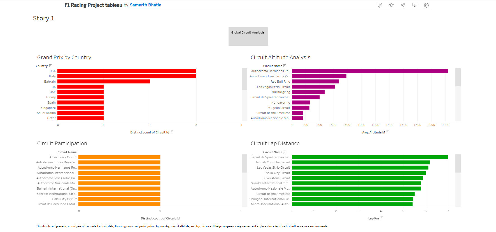

# Formula 1 Race Intelligence Dashboard

## Project Overview
This project analyses Formula 1 circuit data using Tableau.

## Dashboard Preview

## Objectives
- Analyse circuit participation by country.
- Compare circuit altitudes.
- Examine lap distances across circuits.
- Present findings through an interactive dashboard.

## Tools Used
- Tableau
- CSV dataset
- GitHub

## Project Files
- Tableau workbook
- Project report
- Dashboard screenshots
- https://public.tableau.com/app/profile/samarth.bhatia1231/viz/F1RacingProjecttableau/Story1?publish=yes

## Conclusion
The dashboard provides a visual comparison of Formula 1 circuits and their geographical characteristics.

